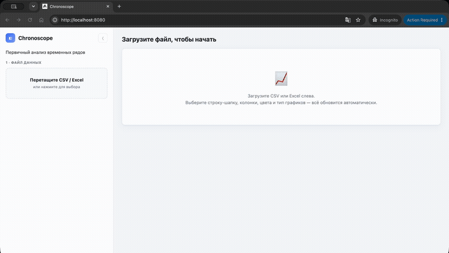
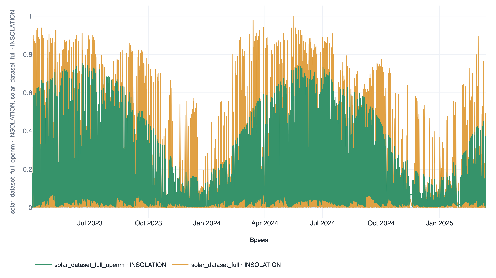
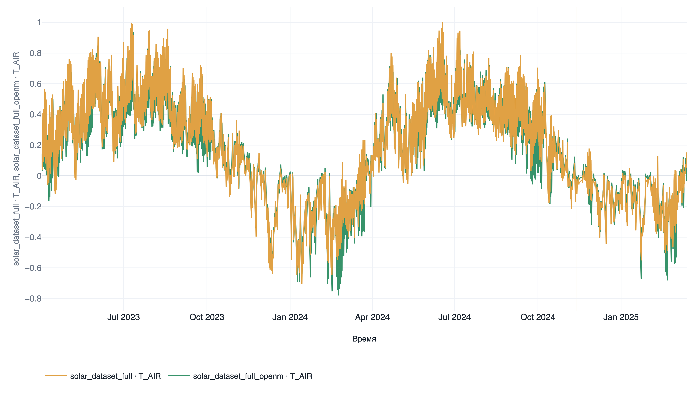

<div align="center">


# Chronoscope

**A private, no-code workbench for exploring time-series data.**
Drop in a CSV or Excel file and get interactive charts, anomaly detection,
correlations, spectra and data cleaning — all in your browser, all on your own
machine.

[](LICENSE)
[](https://github.com/ilartstu/chronoscope/stargazers)


[](#contributing)

<a href="assets/hero.mp4"></a>

<sub>▶ <a href="assets/hero.mp4">Watch the full 2-minute demo</a></sub>

</div>

---

## Why Chronoscope?

- 🔒 **Private by design.** Your data **never leaves your machine.** Chronoscope runs
  locally (or on your own server) with **no sign-up and no cloud.** Uploaded files
  live in a local Docker volume, expire automatically, and the original file on
  disk is **never modified** — all edits apply to a non-destructive working copy.
- ⚡ **No code required.** Upload a file and you are looking at a chart in seconds.
  No notebook, no pandas boilerplate, no plotting scripts.
- 🔬 **Actually deep.** Multi-file comparison, anomaly detection, correlation,
  FFT/ACF spectra, wind rose, missing-data maps, interpolation, normalization and
  high-DPI figure export — not just a line chart.

Built for researchers, engineers and anyone who works with sensor logs, forecasts,
energy/weather data or any CSV with a time column — and would rather not upload it
to someone else's server.

## Quick start

You only need [Docker](https://www.docker.com/).

```bash
git clone https://github.com/ilartstu/chronoscope.git
cd chronoscope
docker compose up --build -d      # or: make up
```

Then open **http://localhost:8080**. That's it — no account, nothing sent anywhere.

Stop it with `docker compose down` (add `-v` to also wipe uploaded files).
Deploying on a server by IP (no domain) is documented in [DEPLOY.md](DEPLOY.md).

## Features

**Load almost anything**
- CSV / TSV / Excel (`.xlsx`, `.xls`), robust to messy, ragged or offset files.
- **Pick the header row** with one click; shifted formats (e.g. Open-Meteo, where
  the header is on line 4) are auto-detected.
- **Up to 5 files at once**, merged on their time axis (outer join) so you can
  compare measurements vs. forecasts on a single chart. Each file's time column
  can be auto-detected or chosen manually.

**Shape your view**
- Choose the X axis (time auto-detected) and any number of Y columns, each with its
  own colour, chart type, line style, width, opacity and left/right Y axis.
- **1–6 Y axes** with an "auto-axes" button that groups series by scale, plus an
  option to align zero across all axes.
- Reorder series by **drag & drop** or arrows to control draw order.
- **Time window:** show only the last/first *N* days or points, or a span from a
  chosen date — handy for zooming into recent data on large files.
- **Normalization:** divide selected columns by their max — either each by its own
  max (compare shapes) or all by a **shared max** (keep amplitude differences
  visible). Also doubles as a quick way to anonymize absolute scales.

**Analyze**
- **Time series** — line / step / markers / line+markers / area / bars, with
  optional rolling mean ± σ.
- **Distribution** — histogram, box plot, violin, ECDF, Q-Q.
- **Correlation** — heatmap (Pearson / Spearman / Kendall), correlation-with-target
  table, scatter / 2-D density with regression, and a scatter-plot matrix (SPLOM).
- **Spectrum / ACF** — FFT periodogram (peaks = periods) and autocorrelation.
- **Wind rose** — polar distribution by direction, stacked by magnitude.
- **Missing map** — heatmap of NaN / zero fractions across all columns over time.
- **Long blocks** — table of long runs of consecutive NaNs / zeros to clean up.
- **Outliers** — list by z-score / IQR / diff / rolling-median, with one-click removal.

**Clean & edit (non-destructive)**
- Drop columns, rows and blocks; rename columns; blank out bad cells; linearly
  interpolate short gaps and outliers; sort by time.
- Every edit is a working copy — the original file is untouched and changes are only
  baked into the file you download. The **Table** view mirrors every choice you make
  on the left (selected columns, X axis, normalization) and updates live.

**Export**
- Data (CSV / Excel) and per-column statistics.
- Charts as **PNG / JPEG / SVG** with a dedicated dialog: pick which charts to save,
  aspect ratio, exact pixel size, **DPI**, and quality presets (HD / Full HD / 2K /
  4K) — rendered crisply as true vectors, so higher quality never shrinks the labels.
- Save all your settings as a **JSON preset** and reload it later.

## Screenshots

> UI screenshots coming soon. Below: two data sources (sensor vs. forecast) overlaid
> on a single time-series chart.

<p align="center">
  
  
</p>

## Use cases

- **Energy & weather:** solar/wind production, insolation, meteo logs; compare
  measured sensor data against saved forecasts (Open-Meteo & friends).
- **Research & lab work:** quick first look at any experimental time series —
  gaps, outliers, periodicity, correlations — before writing a single line of code.
- **Data cleaning:** find and remove long NaN/zero runs and outliers, then export a
  cleaned file.

## Tech stack

| Layer    | Technology                                   |
|----------|----------------------------------------------|
| Backend  | FastAPI + pandas / numpy (parsing & analysis) |
| Frontend | React (Vite) + Plotly.js                     |
| Delivery | Docker Compose (2 services, nginx reverse proxy) |

- Frontend (nginx) on `:8080`, proxies `/api/*` to the backend.
- Backend (FastAPI) on `:8000`, interactive docs at `http://localhost:8000/docs`.

## Local development (without Docker)

```bash
# backend
cd backend && pip install -r requirements.txt
DATA_DIR=./data uvicorn app.main:app --reload --port 8000

# frontend (needs Node 18+)
cd frontend && npm install && npm run dev   # http://localhost:5173
```

## Project structure

```
chronoscope/
├── docker-compose.yml
├── backend/            # FastAPI
│   └── app/
│       ├── main.py       # endpoints: upload / inspect / series / combine / export
│       ├── parsing.py    # CSV/Excel reading, header-row detection
│       ├── analysis.py   # stats, NaN/zero regions, anomalies
│       ├── storage.py    # temporary storage of uploads
│       └── models.py     # request schemas
└── frontend/           # React + Vite + Plotly
    └── src/
        ├── App.jsx        # state orchestration
        └── components/    # Uploader, HeaderPicker, ColumnConfig, Chart, ...
```

## Roadmap

Chronoscope is actively evolving. Planned / in progress:

- 🎨 Cleaner main-screen layout and easier navigation between views.
- 🌙 Dark theme.
- 🧭 Visual and UX polish across the analysis modes.
- 🐛 Ongoing bug fixes as it gets real-world use.

Ideas and feedback are very welcome — open an issue.

## Contributing

Contributions are welcome! Open an issue to discuss a bug or idea, or send a pull
request. If Chronoscope is useful to you, a ⭐ really helps others find it.

## License

Released under the license in the [LICENSE](LICENSE) file.

---

<div align="center">
Made by <a href="https://github.com/ilartstu">ilartstu</a>
</div>
